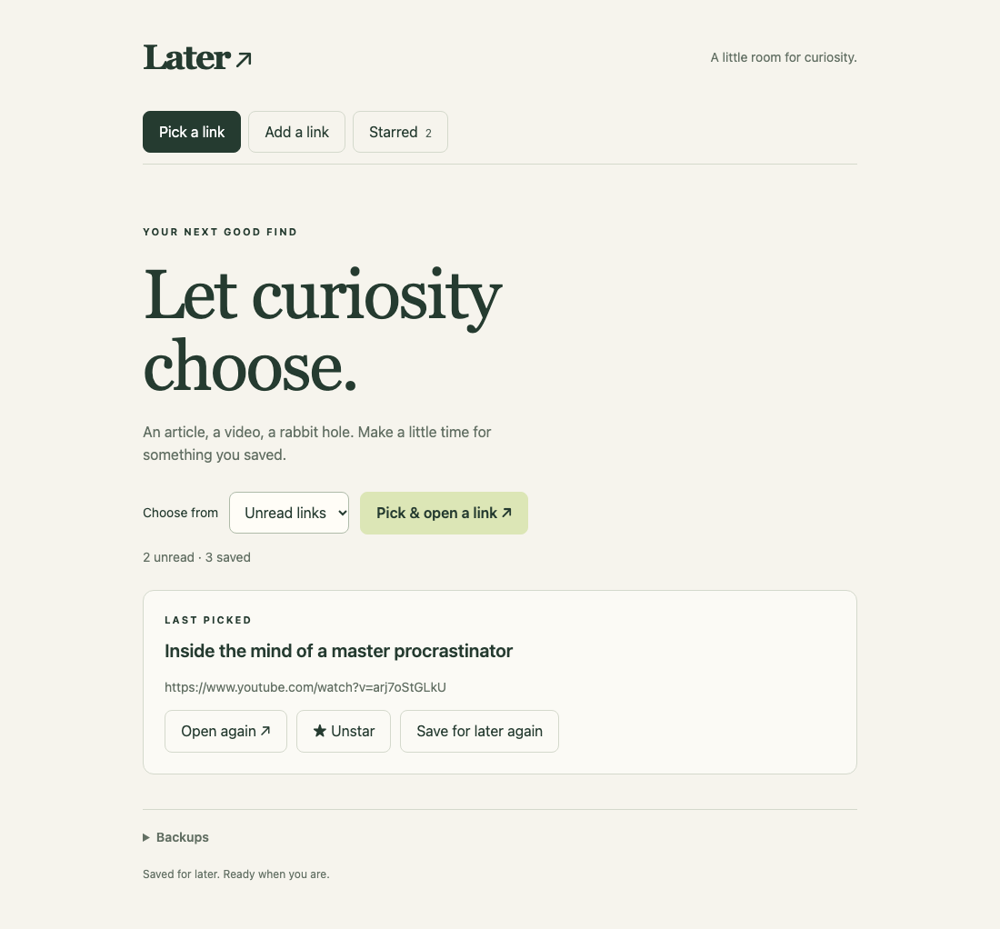
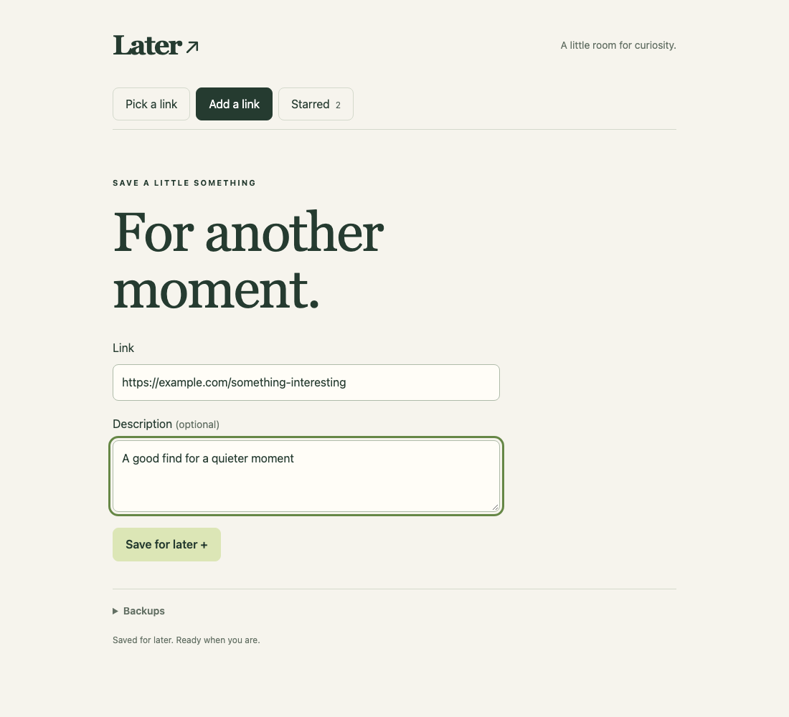
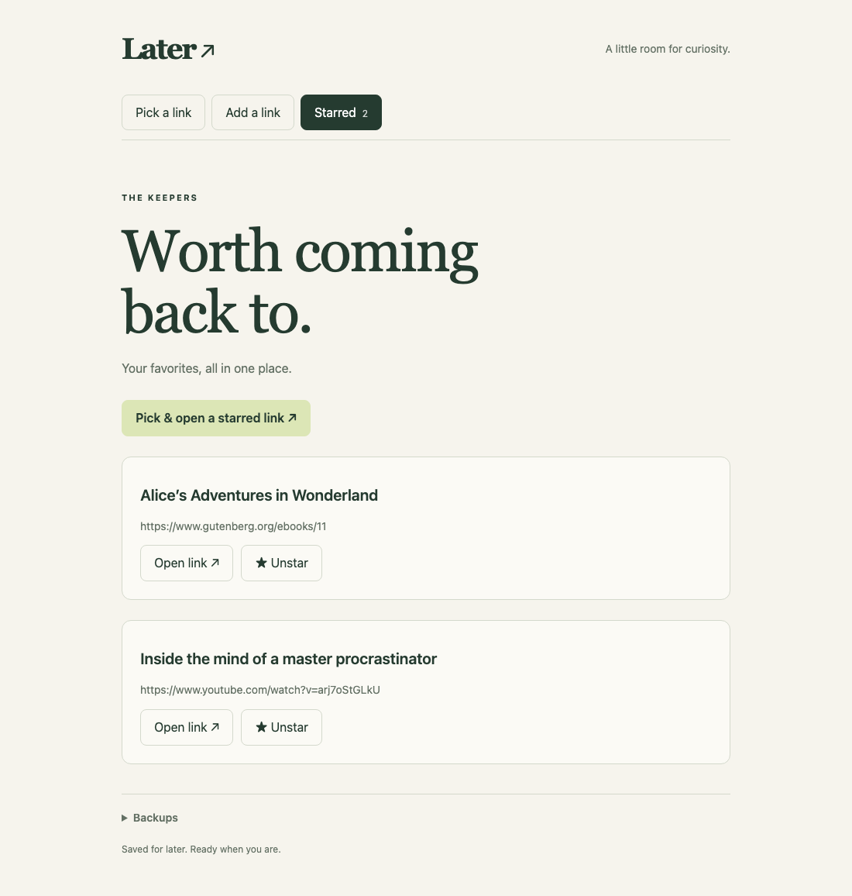
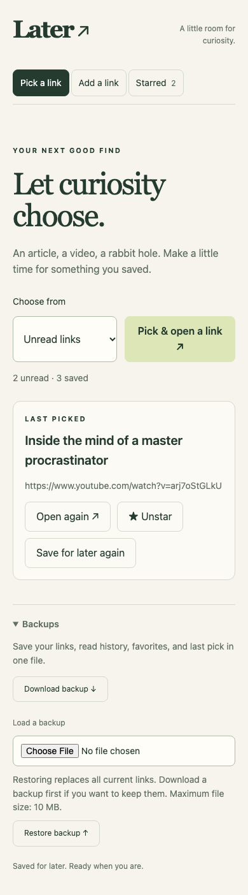

# Later ↗

A tiny, self-hosted queue for articles, YouTube videos, and anything else with a link. Flask, SQLite, and responsive vanilla HTML/CSS/JS. No accounts, external services, AI, or build step.

## Screenshots

Pick a saved link and star the keepers:



Save a URL with an optional description:



Browse favorites or randomly revisit one:



The mobile layout includes download and restore controls for backups:



## Run

Requires Python 3.10+.

```sh
git clone git@github.com:archieLa/later.git
cd later
python3 -m venv .venv
.venv/bin/python -m pip install -r requirements.txt
.venv/bin/python app.py
```

Open **http://localhost:5050** on this computer, or **http://YOUR-SERVER-LAN-IP:5050** from another device on the same network. The server uses Waitress and listens on `0.0.0.0` by default. Allow TCP port 5050 through the server firewall if needed.

Optional settings:

```sh
LATER_HOST=127.0.0.1 LATER_PORT=8080 LATER_DATABASE=/absolute/path/later.sqlite3 .venv/bin/python app.py
```

Use `LATER_HOST=0.0.0.0` for LAN access. This personal app has no login: everyone with network access can view and change its shared queue. Keep it on a trusted LAN; do not forward its port to the internet.

## Use

- **Add a link:** paste a full `http://` or `https://` URL. The description is optional.
- **Pick a link:** choose unread links or all links. A random pick is immediately marked read and opens in a new tab. Keep the Later tab open to star/unstar it or open the last pick again.
- **Too long for right now?** Click **Save for later again** on the last pick to mark it unread. It stays available to reopen and keeps its favorite status. It can be picked again immediately, including on your next unread pick.
- **Starred:** browse favorites, unstar them, or randomly open one again. Random starred picks also become the last pick.

If the browser blocks the new tab, use **Open again** on the selected item. Read means picked, even if its page fails to load. All/Starred selections may repeat items. The last pick and favorites are shared across devices and survive restarts.

## Data and backups

Open **Backups** at the bottom of the app:

- **Download backup** saves a dated `.json` file containing every link, description, read status, favorite, and the last pick. You can keep using the server while downloading.
- **Load a backup** lets you choose that file from your device, then **Restore backup** asks you to confirm replacing the current queue. Download a backup of the current queue first if you want to keep it. Backups can move between your Mac and Pi.

Restores accept Later version 1 JSON backups up to 10 MB. Invalid files leave the queue unchanged; valid restores replace everything together and take effect immediately, without restarting. An empty backup clears the queue after confirmation.

The database is created automatically at `instance/later.sqlite3` (or `LATER_DATABASE`) and excluded from Git. Keep its directory writable by the server user. Updating the code does not clear saved links.

## Raspberry Pi autostart

On Raspberry Pi OS, install `python3-venv` and `git`, clone this repo into `/home/YOUR_USER/later`, then follow the Run setup above. Create `/etc/systemd/system/later.service` using [deploy/later.service](deploy/later.service). Replace **every** `YOUR_USER` with your actual Pi username, and adjust the paths if you cloned elsewhere.

```sh
sudo apt update
sudo apt install python3-venv git
# After cloning and setting up the virtual environment:
sudo cp deploy/later.service /etc/systemd/system/later.service
sudo nano /etc/systemd/system/later.service
sudo systemctl daemon-reload
sudo systemctl enable --now later
sudo systemctl status later
```

Open `http://YOUR-PI-IP:5050` from your phone or computer. Find the Pi IP with `hostname -I`; a router DHCP reservation keeps it stable. Logs: `journalctl -u later -n 50`. Stop/restart: `sudo systemctl stop later` / `sudo systemctl restart later`.

## Tests

```sh
.venv/bin/python -m unittest discover -s tests -v
```

Tests use temporary databases and cover validation, persistence, read filters, favorites, last pick, malformed requests, and concurrent unread selection.

Optional browser checks (Chromium, Firefox, and WebKit; desktop and phone widths):

```sh
.venv/bin/python -m pip install playwright
.venv/bin/python -m playwright install chromium firefox webkit
.venv/bin/python tests/browser_smoke.py
```

Browser checks use a temporary database and a local test server, without changing your saved links.

To run only installed/supported engines, append `--browsers chromium firefox`. WebKit checks depend on your operating system's support for the downloaded engine.
